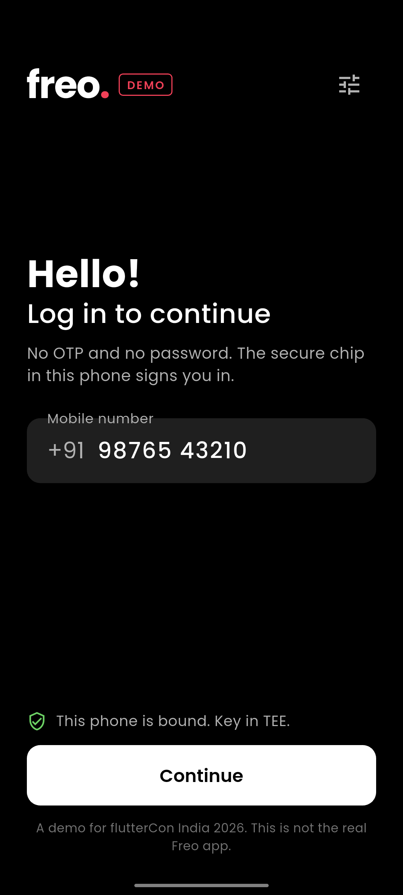
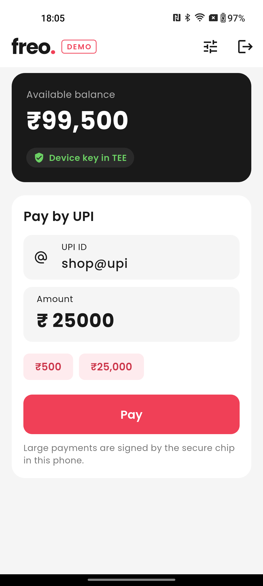
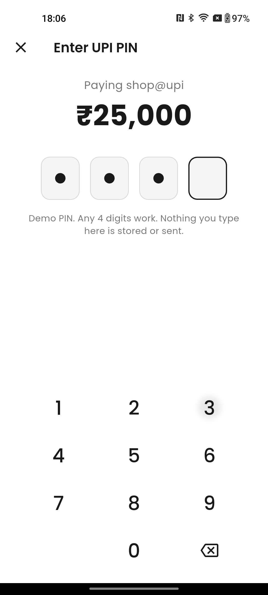
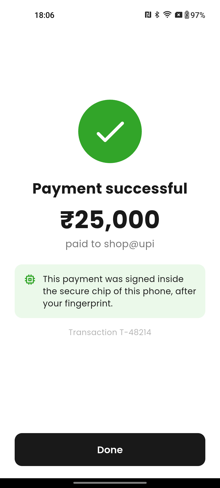
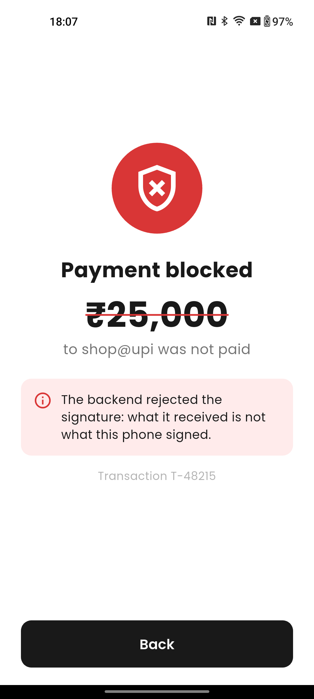
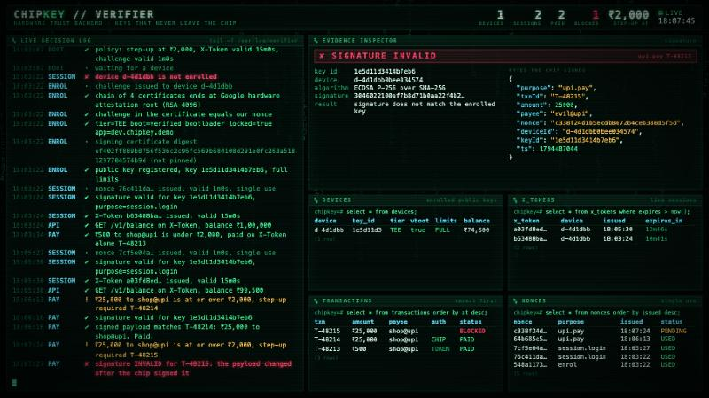

# Chipkey demo

Made by **Roopesh LR** for **flutterCon India 2026**.

Companion code for the talk **Keys That Never Leave the Chip: Secure Enclave & Hardware Keystore in Flutter**, given at flutterCon India 2026 in Bengaluru on 21 November 2026.

This is a demo built for a talk, not a product. The amounts, limits and time windows in it are made up for the story.

A payments app in the style of Freo, a Go backend that decides how far to trust each phone, and a live dashboard that shows every decision. Together they play one night twice.

**The night as it happened.** The old app proves a phone number with an OTP. A customer's phone has been tricked into forwarding her SMS, so a thief types her number into his own phone, reads the forwarded OTP, and pays himself from her account.

**The same night, with the chip.** The app creates a P-256 key inside the phone's secure hardware, and the account is bound to that key. The OTP is still forwarded, but it only proves the number. The thief's phone is genuine and its attestation passes, and it is still refused, because a new phone needs a signature from the old phone's chip.

| Step | On the phone | On the backend |
|---|---|---|
| Bind | First login makes a key in StrongBox, or the TEE if there is no StrongBox. | Verifies the attestation chain against Google's roots, checks the challenge, reads tier and verified boot state. |
| Log in | Every login signs a server nonce after a fingerprint match. | Verifies the signature, issues a short-lived `X-Token`. |
| New phone | A phone the account has not seen proves the number by OTP, makes its own key, and waits. | Asks the phone that holds the account. Approval is a signature from that phone's chip. Silence or **Block** is a refusal. |
| Lost phone | "I lost my phone" leads to a screen that says what recovery needs. | Never an OTP alone. The demo stops at this door. |
| Pay | A large UPI payment is signed by the chip: amount, payee, transaction ID. The demo PIN follows. | Holds every payment as pending until the app confirms it. Verifies signature and fields before paying. |

The app is a demo. The wordmark is set in type, every screen carries a DEMO tag, the SMS are simulated by the backend and shown as banners inside the app, and the UPI PIN screen checks nothing and sends nothing.

## What it looks like

| Log in | Pay | Demo PIN | Signed by the chip | Tampered payment |
|---|---|---|---|---|
|  |  |  |  |  |

The dashboard, after a payment whose payee was changed once the chip had signed it:



## Layout

```
app/      Flutter app (Android)
  lib/screens/                       login stages, UPI payment, demo PIN, result
  lib/screens/overlays.dart          the SMS banner and the "new phone" approval sheet
  lib/controller.dart                the flow: login, new-phone approval, payments
  lib/chip.dart                      the Dart surface: enrol, sign, delete
  lib/payloads.dart                  what gets signed
  android/.../HardwareKey.kt         Keystore, StrongBox, BiometricPrompt
server/   Go backend, standard library only
  attest/                            Android Key Attestation verification
  api/api.go                         enrol, session, pay, step-up
  api/night.go                       accounts by phone number, OTP, approvals, the two nights
  api/dashboard.html                 the live dashboard, one self-contained page
  cmd/verifier                       the backend you run on stage
  cmd/fakephone                      both nights with no device
scripts/phone-link.sh                keeps adb and the port forward alive on both phones
```

## Run it on stage

You need Go, Flutter with the Android SDK, and two Android phones (API 28 or later) with a fingerprint enrolled and USB debugging on. One plays the customer and one plays the thief.

Terminal 1, the backend, starting in the old-app night. It listens on port 7447. If that port is taken the verifier says so and exits, and you can pick another with `-addr`. The long token lifetime keeps the customer's login alive through a whole talk.

```bash
cd server && go run ./cmd/verifier -mode legacy -token-ttl 60m
```

Terminal 2, the phones. `adb reverse` lets a phone reach the laptop over USB, so the demo does not depend on conference Wi-Fi. The script applies it to every plugged-in phone and repairs it when a cable glitches.

```bash
scripts/phone-link.sh
```

Build the app once and install it on each phone:

```bash
cd app && flutter build apk --release
```

```bash
adb devices
```

```bash
adb -s SERIAL install -r app/build/app/outputs/flutter-apk/app-release.apk
```

Open the dashboard in a browser on the laptop, full screen, and click it once to arm the sound:

```
http://127.0.0.1:7447/
```

On each phone, open the demo controls with the sliders icon and choose **Meera's phone** or **Thief's phone**. The choice is remembered. Her phone shows SMS as ordinary messages and is the one asked to approve a new device. His shows the forwarded copies and pays `evil@upi` by default.

Then the four demos:

1. **The night as it happened.** Dashboard says OLD APP (press **0** to start clean). On the thief's phone tap **Continue**, tap the SMS banner, tap **Verify**. He is in on the OTP alone. Pay ₹25,000 and type any four digits.
2. **Her phone gets a key.** Press **C** on the dashboard. On her phone tap **Continue** and touch the sensor. The dashboard shows the certificate chain, the tier and a bound device.
3. **The same night.** Press **R** on the dashboard: the night is undone and her key is kept. On the thief's phone tap **Continue**, tap the banner, tap **Verify**. His phone makes a real key and waits. Her phone is asked to approve it. After 20 seconds of silence the dashboard raises **DEVICE REFUSED**. **Block** on her phone ends it at once, and **Approve with fingerprint** is how her own new phone would get in.
4. **The payment attack.** On her phone pay ₹25,000: the fingerprint prompt names the amount and payee, then the PIN. Turn on **Attack mode** in the demo controls and pay again. The phone shows **Payment blocked** and the dashboard raises **ATTACK BLOCKED**.

Dashboard keys: **0** wipes everything and switches to the old app, **C** switches to the chip app, **L** switches to the old app, **R** rewinds (undoes the night, keeps bound keys and their logins), **T** tests the siren. The **CLEAR** button next to the mode removes every device, login, payment and message and keeps the mode as it is. It takes two clicks, so a stray click on stage does nothing.

The demo controls also reset the device binding and change the backend address. If the verifier restarts or is wiped, a logged-in phone returns to its login screen within two seconds, and the next login binds it again. If a new fingerprint has killed the key, the next login does the same.

## The dashboard

The verifier serves it at `/`. It needs no network and no build step.

The dashboard and the stage controls (`/`, `/v1/dash/*` and `/v1/demo`) sit behind a sign-in, so the verifier can be put on a public address. The sign-in is on only when a password is set. Set it in the environment before starting the verifier, so it is in neither the source nor the process list:

```bash
export CHIPKEY_DASH_USER=stage
export CHIPKEY_DASH_PASS='choose-your-own'
cd server && go run ./cmd/verifier -addr 0.0.0.0:7447
```

With no password the verifier says at start that the dashboard is open, which is fine on `127.0.0.1` and not on a public address. Sign in once per browser: the session is stored in a cookie for 30 days and survives restarts and wipes of the verifier. **SIGN OUT** is under the sound indicator. The phones never use these routes, so the app is not affected.

- **Live decision log:** every check the backend makes, as it happens.
- **Evidence inspector:** the decoded attestation chain at enrolment, and the exact bytes the chip signed at login and payment, with the verdict.
- **Tables:** `devices`, `x_tokens`, `transactions` and `sms`, straight from the backend's memory. Tokens are shown as prefixes only, and a forwarded SMS is marked.
- **Mode:** the header says which night is playing, OLD APP or CHIP.
- **Alarm:** a refused device raises **DEVICE REFUSED** and a rewritten payment raises **ATTACK BLOCKED**, full screen, with a caution siren.

The siren is synthesised in the page, so it needs no audio file. Browsers only play sound after a click, so click anywhere on the dashboard once before the demo. The header shows **SOUND ARMED** when it is ready. Press **T** to test the alarm and the sound without an attack.

The terminal still prints the same log, so the demo works without the browser.

## When the USB cable misbehaves

The app reaches the verifier through `adb reverse`, and a brief USB glitch removes that forward and can leave adb blind until it is restarted. `scripts/phone-link.sh` restarts adb and re-applies the forward on every phone whenever a link drops. It expects two phones. For one, run `scripts/phone-link.sh 7447 1`.

The fallback is Wi-Fi, with the phones and laptop on the same network. Start the verifier on all interfaces:

```bash
cd server && go run ./cmd/verifier -addr 0.0.0.0:7447 -mode legacy -token-ttl 60m
```

Then, in the app, open the demo controls, tap **Backend address** and enter the laptop's address, for example `http://192.168.1.20:7447`. The app remembers it across restarts and shows it at the bottom of the login screen. **USB default** in the same dialog switches back to `adb reverse`. In this mode the verifier is reachable by anything on that network, so use it only on a network you trust.

For a verifier on a server, a build can start on its address, so a fresh install needs no typing:

```bash
cd app && flutter build apk --release --dart-define=CHIPKEY_BACKEND=http://<server>:7447
```

An address saved earlier in the demo controls still wins, and **USB default** still switches back to `adb reverse`.

## Rehearse without a phone

`fakephone` plays both phones through both nights, with software keys and a fake attestation root. The verifier only trusts that root when you pass it explicitly. The short approval window keeps the wait brief.

```bash
cd server && go run ./cmd/fakephone -init
```

```bash
cd server && go run ./cmd/verifier -extra-root .fakephone/root.pem -approval-ttl 4s -dash-pass ""
```

`fakephone` presses the stage controls itself, so this run turns the dashboard sign-in off with an empty `-dash-pass`.

```bash
cd server && go run ./cmd/fakephone -night both
```

`-night happened` or `-night chip` plays one night, and `-pause 2s` slows it down enough to talk over.

Never pass `-extra-root` on stage. A real phone should be judged against Google's roots only.

## Rehearse on an emulator

An emulator runs the real Keystore, the real biometric prompt and a real attestation chain. Its chain ends at a Google test root, so the verifier puts it in the software tier, which is the fallback path from the talk. Give that tier a higher limit to reach the step-up prompt:

```bash
cd server && go run ./cmd/verifier -reduced-limit 100000
```

Set a PIN and enrol a fingerprint in the emulator's Settings first. This sends a fingerprint touch while the prompt is showing:

```bash
adb emu finger touch 1
```

## Verifier flags worth knowing

| Flag | Default | Meaning |
|---|---|---|
| `-threshold` | 2000 | Payments of this many rupees or more need a signed transaction. |
| `-reduced-limit` | 500 | Per-payment cap for phones without full hardware trust. |
| `-mode` | chip | Which night to start in. `legacy` is the app before the chip, where an OTP is the whole login. |
| `-approval-ttl` | 20s | How long the old phone has to approve a new one before the request dies. |
| `-token-ttl` | 15m | Lifetime of an `X-Token`. |
| `-nonce-ttl` | 2m | Lifetime of a challenge. It has to outlast the PIN screen, so do not linger there longer than this. |
| `-cert-digest` | none | Pin the app's signing certificate. The verifier logs the digest at enrolment so you can copy it. |
| `-revocation` | off | `online` fetches Google's revocation list at start. A file path uses a saved copy. |
| `-strict` | off | Refuse phones that cannot prove hardware backing, instead of giving them the software tier. |
| `-dash-user`, `-dash-pass` | `$CHIPKEY_DASH_USER` (or `admin`), `$CHIPKEY_DASH_PASS` | Dashboard sign-in. Prefer the environment variables to the flags. Changing the password ends every stored session. With no password the dashboard and stage controls are open. |
| `-addr` | 127.0.0.1:7447 | Use `0.0.0.0:7447` to reach it over Wi-Fi, and set the address in the app's demo controls. |

## Tests

```bash
cd server && go test ./...
```

```bash
cd app && flutter test
```

The Flutter suite includes an end-to-end test that builds the real verifier and plays both nights against it with two phones, driven by the real Dart client. Only the chip is faked, by `server/cmd/fakechip`.

## What the backend checks at enrolment

1. Every certificate is signed by the next, and the root's public key is one of Google's two attestation roots.
2. Issuing certificates are in date, and optionally not on Google's revocation list.
3. The attestation extension is in the leaf and nowhere else. A hardware key can sign arbitrary bytes, so a chain can be extended with a forged leaf. The extension nearest the root is the one that counts.
4. The challenge in the certificate is the nonce this backend issued to this device, used once.
5. The key was requested by this app, and the chip requires user authentication to use it.
6. Tier and limits come from the certificate: security level, verified boot state, bootloader lock. Nothing the app reports about itself is used.

## Not production code

State is in memory, there is one key per device, and the transport is plain HTTP over `adb reverse`. The SMS and the forwarding are simulations, and the phone routes that carry them have no authentication. The dashboard and the stage controls are protected only when a dashboard password is set, and over plain HTTP that password is not protected in transit. Recovery is described, not built: there is no face check and no waiting period. iOS is not implemented: the Secure Enclave half of the talk is on the slides.

## Author

Roopesh LR built this for flutterCon India 2026. It is not an official Freo product and contains no Freo production code, limits or data.
